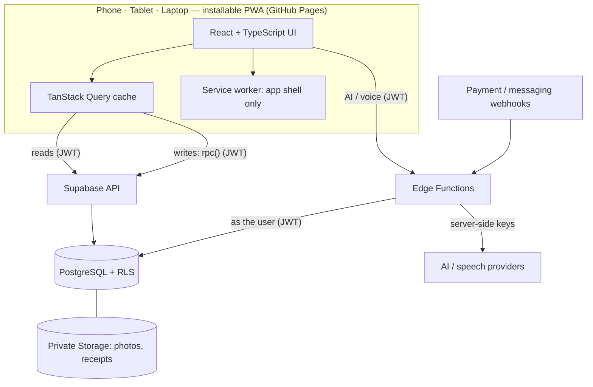

# XS Gym — Architecture (Phase 2 draft)

## 1. Overview

**Trust boundaries:** the browser is untrusted. PostgreSQL (RLS + command
functions) is the authority for permissions, money, dates and entitlements.
Edge Functions hold third-party secrets and forward the user's identity.

## 2. Request patterns

| Pattern | Path | Used for |
|---|---|---|
| Read | `supabase.from(table).select()` → RLS | Lists, profiles, reports (via `stable` SQL functions for aggregates) |
| Write | `supabase.rpc('record_payment', …)` → command function | Every mutation: members, memberships, attendance, payments, expenses, settings |
| Secret-bearing | `supabase.functions.invoke('ai-chat')` → Edge Function → same RPCs as the user | AI, voice sessions, notifications, webhooks |
| Platform admin | Separate Edge Function, allow-listed, audited | Tenant activation, trial start, verified SaaS payments |

Each write carries a client-generated **idempotency key** (UUID) created when the
form opens, so a double tap or network retry never duplicates a record.

## 3. Tenant resolution

After sign-in the app loads the user's `gym_staff` rows. One gym → open it. Several
→ gym picker. The selected `gym_id` is kept in the URL (`/g/<slug>/…`) and sent
with every call; the database re-verifies it every time.

## 4. Frontend structure

Feature folders per blueprint §6 (`src/features/members`, `payments`, …). Each
feature owns its routes, queries, forms (React Hook Form + Zod) and components.
Shared: `components/ui`, `lib/money` (paise ↔ display, no float maths),
`lib/dates` (display in gym timezone), `lib/permissions` (UI hints only).

**Responsive shell** (blueprint §3): one layout that switches on available width,
never user-agent. < 900 px: bottom navigation + compact top bar; full-screen
forms and bottom sheets. ≥ 900 px: side navigation; two-panel views. ≥ 1200 px:
persistent sidebar, dense tables. Orientation change re-flows without losing form
state.

## 5. Performance budget

| Metric | Target |
|---|---|
| Initial JS (gzip) for sign-in + dashboard | ≤ 170 KB |
| LCP on mid-range Android, 4G | < 2.5 s |
| INP | < 200 ms |
| CLS | < 0.1 |
| Route transition (cached) | < 300 ms |

Route-level code splitting; charts and reports lazy-loaded; server pagination;
debounced search. Bundle size checked in CI.

## 6. Offline (conservative)

Service worker caches the app shell and static assets only. An offline banner and
"last synced" time are shown. **No queued writes** in P0: payments, check-ins and
edits require a connection. Private member data is not stored in the service-worker
cache.

## 7. Observability

Web Vitals, JS errors and API error rates reported to a lightweight endpoint
(Edge Function → table) with PII stripped. AI/voice latency, fallbacks and quota
use logged as metadata only. Choice of external tool deferred to Phase 3.

## 8. Decision records

See `DECISIONS/`: ADR-0001 stack, ADR-0002 command functions, ADR-0003 money
ledger, ADR-0004 date semantics, ADR-0005 hosting, ADR-0006 test strategy,
ADR-0007 brand assets and fonts, ADR-0008 `gym_staff` naming.
