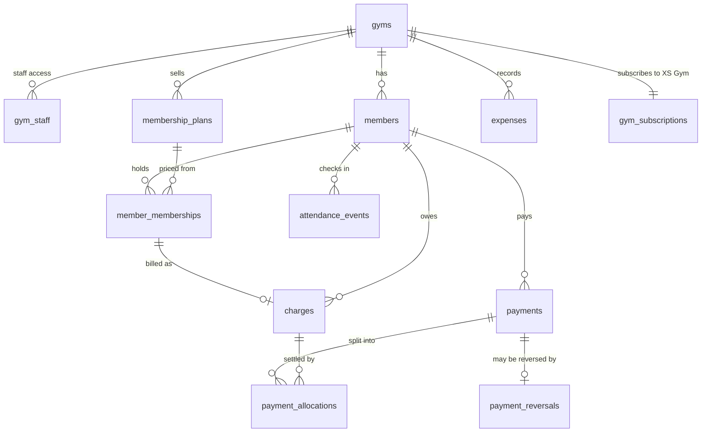

# XS Gym — Database Design (Phase 2 draft)

Status: **draft for review**. Logical model only; no migrations are written until
the Phase 2 gate. Rules marked *pending* depend on `OWNER_DECISIONS.md`.

## 1. Conventions

| Topic | Rule |
|---|---|
| Schemas | Tables in `public` (exposed via the API, protected by RLS). Helper functions in `private` (not exposed). Command functions (all writes) in `public`, `SECURITY DEFINER`, `SET search_path = ''`. |
| Keys | `id uuid primary key default gen_random_uuid()`. Every tenant table also has `unique (gym_id, id)`. |
| Tenant integrity | Every tenant row has `gym_id uuid not null`. Child rows reference parents by **composite FK** `(gym_id, parent_id) → parent(gym_id, id)`, so a row can never point at another gym's record, even with a forged ID. |
| Time | `timestamptz` stored in UTC. Calendar dates (membership start/end, expense date) are `date`. Business "today" = `(now() at time zone gyms.timezone)::date`. The browser clock is never used. |
| Money | `bigint` **paise**. Amount columns `check (x > 0)` (or `>= 0` for discounts). Currency `INR` on `gyms`. No floats anywhere, in SQL or TypeScript. |
| Status fields | `text` + `check` constraint (easier to extend than enums). |
| Audit columns | `created_at`, `created_by`, `updated_at` (trigger-maintained). |
| Deletion | No hard deletes of members, financial or audit rows. Archive or reverse instead. No `on delete cascade` on business records. |
| Naming | `snake_case`, plural tables, `*_paise` for money, `*_at` timestamps, `*_date` dates. |

## 2. Tables

### Platform and identity
| Table | Purpose / key columns |
|---|---|
| `gyms` | Tenant. `name, slug unique, timezone default 'Asia/Kolkata', currency default 'INR', grace_days, status, logo_path, settings jsonb (validated)` |
| `profiles` | 1:1 with `auth.users`. `display_name, phone, avatar_path` |
| `gym_staff` | Staff access to a gym (blueprint's `gym_memberships`, renamed — ADR-0008). `gym_id, user_id, role, status, unique (gym_id, user_id)` |
| `role_permissions` | `role, permission` — seeded matrix (see `SECURITY.md` §3) |

### Members and memberships
| Table | Purpose / key columns |
|---|---|
| `members` | `member_no` (per-gym sequence, D-08), `legacy_member_no`, `full_name, phone_e164, phone_normalized, email, dob, gender, address, emergency_contact, photo_path, join_date, status (active/archived)`, `unique (gym_id, phone_normalized)` among active members |
| `member_notes` | Restricted notes, separate table so read access can differ |
| `membership_plans` | `name, duration_unit (day/month), duration_count, price_paise, description, status` |
| `member_memberships` | One period of a plan. `member_id, plan_id, start_date, end_date, effective_end_date (incl. freezes), price_paise (snapshot), status (active/cancelled), renewed_from_id, charge_id` |
| `membership_freezes` | `member_membership_id, start_date, end_date, reason` — *pending D-12* |
| `membership_events` | Append-only history: created, renewed, frozen, unfrozen, cancelled |

### Attendance
| `attendance_events` | `member_id, checked_in_at (server now()), source (desk/qr/kiosk), status_at_checkin, override_reason, recorded_by, corrected_from_id` — corrections insert a new row and mark the old one superseded; nothing is edited in place |

### Money (ledger — ADR-0003)
| Table | Purpose / key columns |
|---|---|
| `charges` | **What a member owes** (added — blueprint gap B2). `member_id, kind (membership/admission/pt/other), member_membership_id, gross_paise > 0, discount_paise >= 0, discount_reason, net_paise generated (gross − discount) check >= 0, due_date, status (open/void), void_reason` |
| `payments` | **What was received.** `member_id, amount_paise > 0, method (cash/upi/card/bank/other), received_at, reference, external_ref, verification ('manual'), received_by, notes, idempotency_key`, `unique (gym_id, idempotency_key)`, `unique (gym_id, external_ref)` where not null |
| `payment_allocations` | `payment_id, charge_id, amount_paise > 0`. Allocated automatically oldest-due-first by `record_payment`. Unallocated remainder = member credit. |
| `payment_reversals` | `payment_id unique, reason, reversed_at, reversed_by`. P0 = full reversal; to correct an amount, reverse and re-record. Partial refunds are P1. |
| `expense_categories`, `expenses` | `category_id, amount_paise > 0, expense_date, method, description, attachment_path, recorded_by`; corrections via `expense_reversals` (same pattern) |

### Staff, workouts, notifications (P0 shape; P1 detail later)
`trainers` (profile link, status), `trainer_assignments`, `notifications`,
`notification_templates`, `communication_consents`; P1: `exercise_library`,
`workout_plans`, `workout_plan_items`.

### SaaS subscription (separate billing domain — never joined to member money)
`saas_plans`, `gym_subscriptions (trial_started_at, trial_ends_at timestamptz, status)`,
`saas_subscription_events`, `saas_payments`, `feature_entitlements`.

### Audit and AI
`audit_logs` (append-only), `ai_conversations`, `ai_messages`, `ai_tool_calls`,
`ai_provider_usage`, `voice_session_events` (metadata only, no audio).

## 3. Core relationships



## 4. Money rules

1. **Dues** for a member = Σ `net_paise` of open charges − Σ allocations from
   non-reversed payments. Never stored; computed by `private.member_balance()`.
2. **Collections** for a date range = Σ `amount_paise` of payments with
   `received_at` in range (gym-local dates). **Reversals** reported separately on
   their reversal date. Net = collections − reversals. History is never rewritten.
3. `record_payment` runs in one transaction: authorise → check entitlement →
   validate → insert payment (idempotency key enforced by unique index) →
   allocate → write audit → return the stored row. A retry with the same key
   returns the original payment, never a second one.
4. Invariant enforced by trigger: Σ allocations of a payment ≤ its amount;
   Σ allocations to a charge ≤ its net amount.
5. A payment is never updated or deleted. Discounts need `discounts.apply`
   permission and a reason.
6. Every report total is tested against a direct sum of raw rows.

## 5. Date rules (*pending D-03, D-04*)

**End date (recommended option A, inclusive last valid day).** For a month plan:
take the month N months after the start month; if the start day does not exist in
that month, the end date is that month's last day; otherwise it is that day minus
one. For a day plan: start + N − 1.

Reference implementation (tests are the authority):

```sql
create function private.membership_end_date(p_start date, p_unit text, p_count int)
returns date language sql immutable set search_path = '' as $$
  select case p_unit
    when 'day' then p_start + (p_count - 1)
    when 'month' then case
      when extract(day from p_start) >
           extract(day from (date_trunc('month', p_start) + make_interval(months => p_count + 1) - interval '1 day'))
      then (date_trunc('month', p_start) + make_interval(months => p_count + 1) - interval '1 day')::date
      else (p_start + make_interval(months => p_count))::date - 1
    end
  end
$$;
```

Required test vectors:

| Start | Plan | End |
|---|---|---|
| 2027-01-15 | 1 month | 2027-02-14 |
| 2027-01-28 | 1 month | 2027-02-27 |
| 2027-01-29 | 1 month | 2027-02-28 |
| 2027-01-31 | 1 month | 2027-02-28 |
| 2028-01-29 | 1 month | 2028-02-28 |
| 2028-01-31 | 1 month | 2028-02-29 |
| 2027-03-01 | 1 month | 2027-03-31 |
| 2027-03-31 | 1 month | 2027-04-30 |
| 2027-08-31 | 3 months | 2027-11-30 |
| 2026-12-31 | 2 months | 2027-02-28 |
| 2027-01-01 | 12 months | 2027-12-31 |
| 2028-02-29 | 12 months | 2029-02-28 |
| 2026-11-05 | 15 days | 2026-11-19 |

**Status** on gym-local date *d*, first match wins: `cancelled` → `frozen` (d inside
a freeze) → `upcoming` (d < start) → `active` (start ≤ d ≤ effective end) →
`grace` (effective end < d ≤ effective end + `grace_days`) → `expired`.

**Renewal start (recommended option A):** day after the old effective end if
renewed on or before the last grace day; otherwise the renewal date. Manager
override with reason, audited.

## 6. Audit log

`audit_logs (id, gym_id, occurred_at, actor_user_id, actor_kind (user/ai/system/platform_admin), action, entity, entity_id, before jsonb, after jsonb, reason, ai_tool_call_id, request_id)`.
Written only by command functions. No `UPDATE`/`DELETE` grants to any API role,
plus a trigger that rejects updates and deletes. Readable by `audit.read`.
`before`/`after` exclude photos and restricted notes.

## 7. Indexes (initial)

`(gym_id, status)` on members, memberships, charges; `(gym_id, phone_normalized)`;
`(gym_id, member_no)` unique; trigram index on `full_name` for search;
`(gym_id, effective_end_date)` for expiry lists; `(gym_id, received_at)` on
payments; `(gym_id, checked_in_at)` on attendance; `(gym_id, expense_date)`;
`(gym_id, occurred_at)` on audit. Every FK column indexed. Review with `EXPLAIN`
on realistic volumes in Phase 4.

## 8. Migrations

`supabase/migrations/<timestamp>_<name>.sql`, created by the Supabase CLI.
Applied migrations are never edited; fix forward. Every migration that adds a
table also enables RLS and adds its policies in the same file. Seeds
(`supabase/seed.sql`) contain synthetic data only.

## 9. Deviations from the blueprint

| Blueprint | Here | Reason |
|---|---|---|
| `gym_memberships` | `gym_staff` | Avoid clash with member memberships (ADR-0008) |
| Payments only | + `charges`, `payment_allocations` | Dues need a record of what is owed (ADR-0003) |
| `payment_reversals` | P0 full reversal; partial refunds P1 | Simpler and fully auditable |
| — | `member_notes`, `membership_freezes`, `expense_reversals` | Separate access rules and immutable corrections |
| — | Composite tenant FKs | Make cross-tenant references impossible at the database level |
